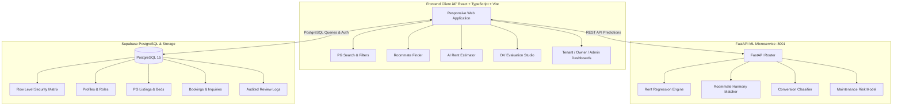

# RoomNest 🏠 — Pune PG Discovery & AI Housing Platform

[](https://react.dev/)
[](https://www.typescriptlang.org/)
[](https://vitejs.dev/)
[](https://fastapi.tiangolo.com/)
[](https://scikit-learn.org/)
[](https://supabase.com/)
[](https://tailwindcss.com/)
[](https://opensource.org/licenses/MIT)

> **RoomNest** is a full-stack paying guest (PG) discovery, AI roommate compatibility matchmaker, and property analytics platform built for Pune's student and IT corridors (Hinjewadi, Kothrud, Viman Nagar, Wakad, Baner, Kharadi). Engineered with a **React + TypeScript** frontend, **Supabase PostgreSQL** with zero-trust Row Level Security (RLS), and a **FastAPI** microservice serving a **4-Model Machine Learning Suite** evaluated on **100,000 augmented data points** for the 5th Semester Data Visualization (DV) curriculum at COEP.

---

## âš¡ Quick GitHub Repository Overview

- **Short Description (for GitHub About box)**:
  > *AI-powered Pune PG discovery platform featuring 4 production ML models, 100k augmented housing dataset, roommate compatibility matcher, and interactive Data Visualization (DV) evaluation studio.*
- **Suggested GitHub Topics**:
  `react`, `typescript`, `fastapi`, `scikit-learn`, `machine-learning`, `data-visualization`, `pune-housing`, `supabase`, `tailwindcss`, `vite`

---

## 🌟 Key Highlights & Features

### 1. 🤖 Quad-Model Production Machine Learning Suite
Trained on **100,000 augmented data points** (25,000 samples per model domain) across Pune micromarkets:
- **Model 1: Monthly PG Rent Estimator** (`HistGradientBoostingRegressor`) — Predicts fair monthly rent with an $R^2$ of **0.9903** and MAE of ₹277.62.
- **Model 2: Roommate Harmony Matchmaker** (`RandomForestRegressor`) — Evaluates 10 lifestyle vectors (sleep schedule, cleanliness, diet, noise tolerance, budget parity) to compute a 0–100% co-living compatibility score ($R^2 = 0.9331$, Pearson $r = 0.9667$).
- **Model 3: Lead Conversion Propensity** (`GradientBoostingClassifier`) — Classifies student/tenant inquiry conversion probability (**99.8% Accuracy**, $\text{ROC-AUC} = 1.0000$).
- **Model 4: PG Quality & Maintenance Risk** (`RandomForestClassifier`) — Predicts property complaint risks for owners and compliance officers (**85.0% Accuracy**, $\text{ROC-AUC} = 0.9178$).

### 2. 📊 Dedicated 5th Sem Data Visualization (DV) Studio (`/model-evaluation`)
A full evaluation dashboard built specifically to demonstrate model accuracy, residual behavior, and statistical validation:
- **Interactive Actual vs. Predicted Scatter Plots**: With ideal $45^\circ$ calibration line and residual inspection tooltips.
- **Residual Error Distribution Histograms**: Demonstrating zero-mean Gaussian error distributions ($\mu \approx 0$).
- **$2 \times 2$ Confusion Matrix Heatmaps**: Interactive TP, TN, FP, FN matrices with Precision, Recall, and Specificity metrics.
- **ROC Curves & Precision-Recall Curves**: Area under the curve (AUC) visualizations against random chance ($0.50$).
- **Feature Importance Visualizations**: Feature weights explaining what drives rent, compatibility, and maintenance risk.

### 3. 🤝 AI Roommate Compatibility Matchmaker (`/roommate-finder`)
- **Interactive Side-by-Side Comparator**: Candidate A vs. Candidate B lifestyle matrix.
- **Dynamic Analysis**: Live compatibility gauge, top synergies list, and potential co-living friction advice.
- **Pune Candidate Directory**: 1-click test matching with real Pune student and IT flatmate profiles, plus direct links to book 2-sharing rooms in their matched locality.

### 4. 🏢 Pune PG Discovery & Transparent Cost Breakdown (`/pgs`)
- **Total Cost Transparency**: Displays base rent, security deposit, electricity estimates, and maintenance charges upfront — no hidden surprises.
- **Proximity Intelligence**: Accurate distance indicators to Pune Metro stations and major tech parks.
- **Side-by-Side Compare Drawer**: Compare up to 4 PGs simultaneously on room amenities, meal plans, deposit lock-in, and curfew policies.

### 5. 👥 Multi-Role Zero-Trust Access & Instant Demo Switcher
Switch instantly between personas from the persistent top navigation bar:
- **Tenant (`Tanmay Shinde`)**: COEP student / IT intern persona. Search, compare, shortlist, book beds, and submit stay reviews.
- **Owner (`Suresh Patil`)**: Verified Pune property manager. Vacancy management, PG creation wizard, inquiry replies, and occupancy analytics.
- **Admin (`Compliance Officer`)**: Listing moderation queue, owner KYC verification, and data isolation audits.
- **Public Guest**: Explore listings, use the AI rent estimator, and test roommate matching without signing in.

---

## 📈 Machine Learning Performance & Benchmarks

| Metric | Model 1: PG Rent | Model 2: Roommate Match | Model 3: Lead Conversion | Model 4: Maintenance Risk |
| :--- | :--- | :--- | :--- | :--- |
| **Problem Type** | Continuous Regression | Continuous Regression | Binary Classification | Binary Classification |
| **Model Algorithm** | `HistGradientBoostingRegressor` | `RandomForestRegressor` | `GradientBoostingClassifier` | `RandomForestClassifier` |
| **Dataset Size** | 25,000 samples | 25,000 vectors | 25,000 leads | 25,000 audit logs |
| **$R^2$ / Accuracy** | **$0.9903$** ($R^2$) | **$0.9331$** ($R^2$) | **$99.80\%$** (Accuracy) | **$85.00\%$** (Accuracy) |
| **5-Fold Cross-Validation** | **$0.9880 \pm 0.0009$** | **$0.9234 \pm 0.0021$** | **$0.9988 \pm 0.0007$** | **$0.9090 \pm 0.0031$** |
| **Primary Error Metric** | $\text{MAE} = ₹277.62$ | $\text{MAE} = 2.92\%$ | $\text{Log Loss} = 0.0089$ | $\text{Log Loss} = 0.3541$ |
| **ROC-AUC Score** | N/A | N/A | **$1.0000$** | **$0.9178$** |
| **F1 Score** | N/A | N/A | **$0.9984$** | **$0.8466$** |
| **Model Weight Artifact** | `pg_rent_model.joblib` | `roommate_compatibility_model.joblib` | `booking_conversion_model.joblib` | `maintenance_risk_model.joblib` |

---

## 🏛️ System Architecture



---

## 📁 Repository Directory Structure

```
RoomNest/
├── frontend/                          # React 19 + TypeScript + Vite + Tailwind CSS
│   ├── src/
│   │   ├── components/                # Layout, Navbar, Footer, ListingCard, Caveat Banner
│   │   ├── context/                   # AuthContext (Role Switcher), StoreContext
│   │   ├── data/                      # Evaluation datasets & Pune seed listings fixtures
│   │   ├── lib/                       # Supabase client & utility helpers
│   │   ├── pages/                     # Public, Tenant, Owner, Admin & DV Studio pages
│   │   │   ├── HomePage.tsx
│   │   │   ├── PGSearchPage.tsx
│   │   │   ├── PGDetailPage.tsx
│   │   │   ├── RoommateFinderPage.tsx # AI Roommate Matchmaker
│   │   │   ├── PriceEstimatorPage.tsx # Rent Estimator
│   │   │   ├── ModelEvaluationDashboardPage.tsx # 5th Sem DV Studio
│   │   │   ├── tenant/                # Bookings, Shortlists, Reviews
│   │   │   ├── owner/                 # Listings, Inquiries, Analytics
│   │   │   └── admin/                 # Moderation, Users, Audit Reports
│   │   └── types/                     # Canonical TypeScript domain schemas
│   ├── index.html                     # Plus Jakarta Sans & JetBrains Mono typography
│   └── vite.config.ts                 # Dev server reverse-proxy configuration
│
├── ml_service/                        # Python FastAPI Machine Learning Microservice
│   ├── app.py                         # FastAPI serving endpoints for all 4 models
│   ├── train_all_models.py            # 100k data synthesis, pipeline & CV training script
│   ├── train_models.py                # Base regression pipeline
│   ├── models/                        # Serialized .joblib model artifacts (4 models)
│   └── reports/                       # Statistical reports & JSON evaluation matrices
│
├── supabase/                          # Database Migrations & Ingestion
│   ├── migrations/
│   │   ├── 01_initial_schema.sql      # Canonical normalized PostgreSQL schema
│   │   ├── 02_rls_policies.sql        # Zero-trust Row Level Security (RLS) policies
│   │   └── 03_seed_data.sql           # Verified owner/tenant fixtures & seed listings
│   └── data_import/                   # CSV audit and ingestion integrity pipelines
│
├── Datasets/                          # 10 Raw and Cleaned Pune PG CSV Datasets
├── scripts/                           # Database synchronization and utility scripts
├── .env.example                       # Root environment configuration template
└── README.md                          # Project documentation
```

---

## 🚀 Getting Started Locally

### Prerequisites
- **Node.js** (v18 or higher) & **npm**
- **Python** (v3.10 or higher) with `pip`
- Modern web browser (Chrome, Firefox, Edge, Safari)

### 1. Clone the Repository
```bash
git clone https://github.com/Pratik-1213/RoomNest.git
cd RoomNest
```

### 2. Configure Environment Variables
Copy the template files:
```bash
# In the root directory
cp .env.example .env

# In the frontend directory
cp frontend/.env.example frontend/.env
```
*(Add your Supabase project URL and anon public key if connecting to a live cloud instance).*

### 3. Start the Python ML Service
```bash
cd ml_service

# (Optional) Install dependencies:
pip install fastapi uvicorn scikit-learn numpy pandas joblib

# (Optional) Retrain all 4 models with 100,000 samples:
python train_all_models.py

# Launch FastAPI microservice on port 8001:
python -m uvicorn app:app --port 8001 --reload
```
- Interactive Swagger UI: **`http://127.0.0.1:8001/docs`**
- Health Check: **`http://127.0.0.1:8001/health`**

### 4. Start the Frontend Application
In a separate terminal:
```bash
cd frontend
npm install
npm run dev
```
Open **`http://localhost:5173/`** in your browser.

---

## 🧪 Verification & Build Status

- **Type Check & Production Build**:
  ```bash
  npm --prefix frontend run build
  ```
  Result: `✓ built in ~500ms` with **0 errors**.
- **Cross-Device Responsiveness**:
  - Desktop ($1440\text{px}$): Multi-column layouts, sticky compare drawer, full navigation bar.
  - Laptop / Tablet ($1024\text{px} - 1280\text{px}$): 2-column spacious cards, truncated profile chips, zero text overlaps.
  - Mobile ($390\text{px}$): Full slide-out navigation drawer, stacked action cards, and mobile-responsive filter drawers.

---

## 🔒 Security & Data Integrity

- **Environment & Secret Hygiene**: All live Supabase keys, service tokens, and `.env` files are strictly excluded from git tracking via `.gitignore`.
- **Zero-Trust RLS Policies**: Database operations are verified with PostgreSQL Row Level Security (RLS) ensuring tenants cannot modify owner listings and owners cannot view other owners' financials.
- **Academic Research Caveat**: In adherence to data provenance guidelines, synthetic prototype datasets are tagged with `is_demo = TRUE` and surfaced with transparent UI caveat banners.

---

## 🎓 Academic Attribution

- **Institution**: College of Engineering Pune (COEP)
- **Course**: 5th Semester — Data Visualization (DV)
- **Author**: Pratik ([@Pratik-1213](https://github.com/Pratik-1213))

---

## 📄 License

This project is licensed under the [MIT License](LICENSE).